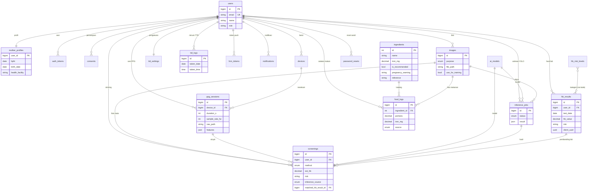

# Anemom: Desain Database (MySQL)

Berkas: `database/schema.sql` (struktur, 20 tabel), `database/seed.sql` (data awal), `database/migrations/` (untuk database yang sudah berjalan), dan `database/dev_sample_ingredients.sql` (data contoh KHUSUS uji).
Diuji di MariaDB 10.11; ditulis agar jalan juga di MySQL 8.

## Keputusan desain (supaya tidak perlu revisi berulang)

| Keputusan | Alasan |
|---|---|
| `client_uuid` + `UNIQUE(user_id, client_uuid)` di semua data buatan pengguna | Aplikasi Android bisa kirim ulang data (sinyal buruk/offline) tanpa membuat duplikat. |
| Hapus lunak (`deleted_at`) + `updated_at` + parameter `?updated_since=` | Sinkronisasi dua arah: HP bisa menarik hanya yang berubah, termasuk yang dihapus. |
| Usia kehamilan, trimester, HPL **tidak disimpan**; dihitung dari `hpht` | Tidak pernah basi, dan tidak ada dua sumber kebenaran. |
| Kategori risiko Hb di tabel `hb_risk_levels` | Batas bisa diubah (mis. setelah konsultasi bidan) tanpa merilis ulang aplikasi. Kolom `risk` berupa teks, jadi level baru (mis. `severe`) tidak perlu `ALTER` tabel besar. |
| Foto dan sinyal PPG mentah di **disk VPS**, DB hanya menyimpan jalur + metadata | Gambar/sinyal besar memperlambat dan menggemukkan DB. |
| `images` dipakai bersama (foto mata dan makanan) | Satu mekanisme unggah, satu aturan izin, satu kebijakan hapus. |
| Hasil skrining (`screenings`) terpisah dari hasil lab (`hb_results`) | Estimasi AI/PPG **bukan** hasil lab. Kolom `matched_hb_result_id` mengaitkannya untuk mengukur akurasi model dan menjadi label pelatihan. |
| `inference_source` = `on_device` / `server` + tabel `inference_jobs` | Mendukung rencana dosen: AI di HP, dengan YOLO di VPS sebagai cadangan. Job gagal dicoba ulang lewat `bin/process_jobs.php`. |
| `ai_models` (versi, runtime, metrik, aktif) | Setiap hasil mencatat model dan versi yang menghasilkannya; model bisa diganti tanpa merilis ulang. |
| `consents` (jenis, versi, waktu) + `images.use_for_training` | Data kesehatan itu sensitif. Foto hanya boleh dipakai melatih model jika ada persetujuan `research_use`. |
| Token sesi disimpan sebagai hash SHA-256 | Jika DB bocor, token tidak bisa dipakai. |
| `ON DELETE CASCADE` dari `users` | Menghapus akun menghapus semua datanya (hak penghapusan data pribadi). |

## Pemetaan fitur ke tabel

| Fitur aplikasi | Tabel |
|---|---|
| Register, Login, Logout | `users`, `mother_profiles`, `auth_tokens`, `ttd_settings` |
| Profil saya (termasuk tanggal lahir, fasilitas kesehatan) | `users`, `mother_profiles` |
| Beranda | dihitung dari `hb_results`, `ttd_logs`, `screenings`, `mother_profiles` (`GET /dashboard`) |
| Input Hb darah, Riwayat/Grafik Hb | `hb_results`, `hb_risk_levels` |
| TTD (kalender, riwayat, pengingat) | `ttd_logs`, `ttd_settings`, `notifications`, `fcm_tokens` |
| AI Scan Mata | `images`, `screenings`, `inference_jobs`, `ai_models` |
| Smartwatch & PPG | `devices`, `ppg_sessions`, `screenings` |
| Rekomendasi Bahan Makanan | `ingredients` (`is_recommended = 1`) |
| Catatan makan / Scan Makanan (opsional, belum direncanakan) | `food_logs`, `images` (purpose `food`) |
| Panduan aman / artikel | `articles` |
| Persetujuan data | `consents` |
| Lupa kata sandi | `password_resets` (endpoint menunggu keputusan jalur email) |

## ERD



## Mengisi bahan makanan rekomendasi

Rekomendasi berupa **bahan makanan** (bukan menu jadi), dan tabel `ingredients` sengaja **kosong** sampai kelompok punya rujukan gizi. Aturan mainnya:

- Bahan hanya tampil di aplikasi jika `is_recommended = 1`. Isi dulu datanya, aktifkan belakangan setelah dicek.
- `reference` mencatat sumber data (mis. TKPI Kemenkes, NIH ODS). `NULL` berarti belum ada rujukan; jangan diaktifkan.
- Bahan yang perlu dibatasi saat hamil (mis. hati ayam, tinggi vitamin A) diisi `pregnancy_warning`. Teksnya muncul sebagai peringatan di aplikasi.
- Urutan tampil diatur `recommend_order` (kecil = lebih awal). Gambar disalin ke `STORAGE_PATH/ingredients/` lalu jalurnya diisi di `image_path`, mis. `ingredients/bayam.jpg`.

Contoh menambah satu bahan (nilai di bawah hanya ilustrasi format, bukan data rujukan):
```sql
INSERT INTO ingredients (name, category, iron_type, serving_desc, serving_grams, iron_mg, reference, is_recommended, recommend_order)
VALUES ('NAMA BAHAN', 'sayur', 'non_heme', '100 g', 100, 0.0, 'SUMBER RUJUKAN', 0, 10);
UPDATE ingredients SET is_recommended = 1 WHERE name = 'NAMA BAHAN';   -- aktifkan setelah dicek
```
Untuk banyak bahan sekaligus, isi dari spreadsheet lalu impor CSV lewat phpMyAdmin/`LOAD DATA`, atau minta saya buatkan skrip impornya.

## Catatan yang perlu dikonfirmasi

1. **Batas Hb.** Nilai awal mengikuti logika aplikasi sekarang: Hb >= 11 normal, 10-10,9 "risiko sedang", < 10 "risiko tinggi". Sebagai pembanding, WHO membagi anemia pada ibu hamil menjadi ringan (10,0-10,9), sedang (7,0-9,9), dan berat (< 7,0) g/dL. Tanyakan ke bidan/dosen mana yang dipakai; cukup ubah isi `hb_risk_levels`.
2. **Artikel di `seed.sql` berstatus draf** (`is_published = 0`); isi medisnya harus ditinjau tenaga kesehatan.
3. **Berapa lama foto disimpan** dan **apakah foto dipakai melatih model** adalah keputusan kebijakan. Skema sudah siap (`consents`, `use_for_training`, hapus akun), tetapi aturannya perlu disepakati kelompok.
4. **Jalur email untuk lupa kata sandi** belum diputuskan (penyedia SMTP; link atau kode 6 digit). Tabel `password_resets` sudah siap untuk keduanya.
5. Peran `tenaga_kesehatan` dan `admin` sudah ada di tabel `users`, tetapi API belum punya endpoint khusus untuk keduanya, jadi bahan makanan diisi lewat SQL.
